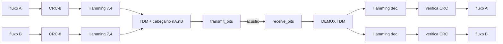

# Arquitetura

Voltar: [[00 - Índice]]

O porte segue a estrutura do código-base (`modem_acustico.zip`). Cada arquivo MATLAB tem o seu correspondente em Python:

| Código-base (MATLAB/Octave) | Python (`modem_py/`) | Papel |
|---|---|---|
| `tx.m` | `tx.py` | ponto de entrada do transmissor (CLI) |
| `transmissor.m` | `transmitter.py` + `framing.py` | quadro, codificação polar, filtro RC, modulação |
| `rcosine.m`, `rcosflt.m` | `rcos.py` | projeto e aplicação do filtro cosseno levantado |
| `rx.m` | `rx.py` | ponto de entrada do receptor (CLI), captura até detectar sinal |
| `receptor_2.m` | `receiver.py` + `framing.py` | Costas, cedo-tarde, decisão, correlação com SFD |
| `teste.m` | `simular.py`, `tests/` | laço TX → RX por software |
| `testes/teste_play.m`, `teste_rec.m` | `audio.py`, `acustico.py` | tocar/gravar na placa de som |
| — | `channel.py` | canal simulado (atraso, ganho, fase, frequência, relógio, ruído) |
| — | `evidence.py` | figuras e `relatorio.json` |
| — | `config.py` | todos os parâmetros num lugar só |

## Cadeia de transmissão e recepção

```mermaid
flowchart LR
  subgraph TX[transmit_bits]
    A[payload bits] --> B[quadro<br/>PRE+SFD+LEN+payload+PRE]
    B --> C[polar ±1]
    C --> D[filtro RC r=0,5]
    D --> E[× cos 2π·2000·t]
    E --> F[normaliza pico]
  end
  F -->|alto-falante → ar → microfone<br/>ou WAV / canal simulado| G
  subgraph RX[receive_bits]
    G[passa-faixa*] --> H[AGC*]
    H --> I[laço de Costas]
    I --> J[× cos fase estimada]
    J --> K[passa-baixas*]
    K --> L[cedo-tarde]
    L --> M[decisão y>0]
    M --> N[correlação SFD<br/>+ correção de polaridade]
    N --> O[lê LEN e extrai payload]
  end
```


`*` = extra que não está no `receptor_2.m` e pode ser desligado (`--professor`). Ver [[Receptor#Extras]].

## Quadro

| Campo | Bits | Conteúdo |
|---|---|---|
| PRE | 40 | 10 × `1` seguidos de 15 × `1 0` (`[ones(1,10) upsample(ones(1,15),2)]`) |
| SFD | 32 | `1100 1110 0011 1100 0011 1000 1100 1010` |
| LEN | 8 | número de bytes do payload (0 a 255) |
| payload | 8·LEN | dados, bytes LSB primeiro (`de2bi`/`bi2de`) |
| PRE | 40 | repetido no fim: o `rcosflt` corta os últimos 3 símbolos (atraso do filtro) |

Exemplo: "OLA" (3 bytes) → 144 bits → 11 520 amostras → 1,44 s de áudio.

## Interfaces para a equipe

A camada física trabalha só com bits. O CRC/Hamming (Renato) e o TDM (Claus) entram **por cima**, sem mexer na modulação:

```python
from modem_py.transmitter import transmit_bits
from modem_py.receiver import receive_bits

audio = transmit_bits(bits)            # numpy uint8 (0/1) -> amostras float em [-1, 1] a 8 kHz
bits_rx, info = receive_bits(audio)    # amostras -> payload em bits + diagnóstico
info["ok"]       # SFD encontrado (pico >= 0,9 * 32)
info["nbytes"]   # campo LEN lido
info["inverted"] # houve correção da ambiguidade de 180 graus
```

Ordem prevista no sistema completo (proposta do Marco 1):



Pontos de atenção para quem integra:
- `transmit_bits` completa o payload com zeros até um múltiplo de 8. O receptor devolve os bits completados, então quem tira o enchimento é a camada de cima. O cabeçalho TDM $(n_A, n_B)$ já carrega os tamanhos.
- O limite é de 255 bytes por quadro (campo LEN de 8 bits, como no original). Com Hamming (7,4), 1 byte de dados vira 14 bits, o que dá ~145 bytes de dados úteis por quadro.
- Para injetar erros de forma controlada em software, use `channel.flip_bits(bits, posições)` sobre os bits **entre** as camadas. A modulação fica fora disso.
